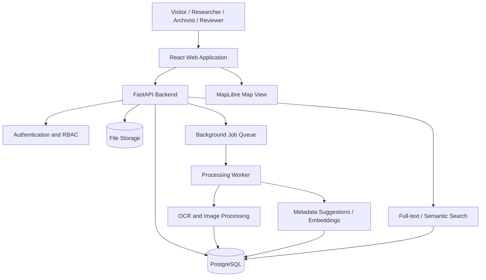
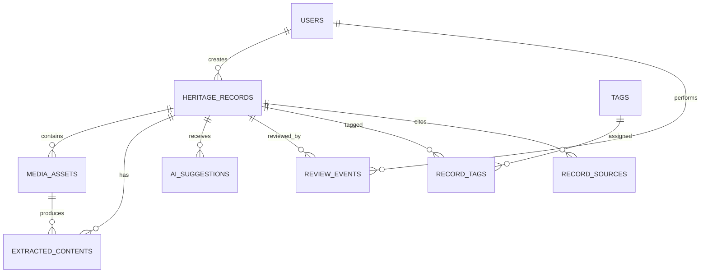

# Software Requirements Specification (SRS)
## Heritage Archive Intelligence Platform
**Problem Statement:** HC26-CULT01 — Digital Revitalisation of Unstructured Cultural & Architectural Heritage Archives  
**Track:** Culture & Digital Heritage | Blithchron '27, IIT Gandhinagar  
**Document status:** Initial development baseline for hackathon prototype  
**Version:** 1.0  
**Date:** 2 November 2026

---

## 1. Purpose

The Heritage Archive Intelligence Platform (working title) converts scattered cultural and architectural heritage material—photographs, scanned documents, field notes, travel journals, presentations and location records—into a searchable, structured and interactive digital archive.

The platform should let an archivist or researcher upload material, extract useful information with AI-assisted processing, review and correct extracted metadata, search across the collection, and explore heritage records through a map and rich record pages.

This SRS defines the prototype scope, user journeys, functional and non-functional requirements, data model, API expectations, architecture, security controls, acceptance criteria, limitations and future roadmap.

## 2. Problem Statement and Proposed Product

### 2.1 Problem
Heritage documentation is often stored in disconnected folders and static documents. Important information is difficult to discover because it is not consistently tagged, geolocated, transcribed or linked to related records.

### 2.2 Proposed solution
Build a web-based, AI-assisted heritage archive with four connected capabilities:

1. **Unified ingestion:** Upload images, PDFs and text notes into one archive.
2. **AI-assisted enrichment:** Extract text from scans, suggest descriptions and tags, identify likely locations and generate searchable text.
3. **Discovery and exploration:** Search by keyword and meaning, filter by region, heritage type, language and date, and browse records on an interactive map.
4. **Human-verified knowledge:** Allow authorised users to review, correct and publish extracted information with provenance and confidence indicators.

### 2.3 Product principles
- AI suggestions must be distinguishable from verified facts.
- Human review is required before uncertain or sensitive information is treated as authoritative.
- Preserve original files and source attribution.
- Design for multilingual content and low-quality archival scans.
- Prefer open standards and portable data formats.
- Do not imply that a generated 3D reconstruction is an accurate historical representation unless validated.

## 3. Goals, Outcomes and Success Metrics

| Goal | Prototype success measure |
|---|---|
| Centralise archives | Supported files can be uploaded and retrieved from one interface |
| Improve discoverability | Users can search titles, descriptions, OCR text and tags |
| Make archives explorable | Geotagged records appear on a map and open into detail pages |
| Reduce manual cataloguing | OCR and AI suggestions prefill editable metadata |
| Preserve trust | Original source, uploader, processing status and review status are recorded |
| Demonstrate usability | A first-time user can find a relevant record without knowing its folder location |

Suggested demo targets (not guaranteed model-performance claims):
- Upload and index a supported file in a few minutes on the demo environment.
- Display OCR output and editable metadata for a sample scanned document.
- Return relevant results for a keyword query and a semantic query.
- Display at least one set of geotagged heritage records on the map.

## 4. Scope

### 4.1 In scope for the hackathon MVP
- User authentication and role-based access.
- Archive upload for JPG, JPEG, PNG, WEBP, PDF and TXT; PPTX may be included if time permits.
- File validation, storage and metadata capture.
- OCR for printed text and best-effort support for Devanagari scans.
- AI-assisted title, summary, language and tag suggestions.
- Manual editing and approval of metadata.
- Full-text and semantic search across indexed records.
- Map-based browsing of records with coordinates.
- Heritage record detail page with original file preview, extracted text, metadata and source information.
- Admin/reviewer workflow for approving, rejecting or correcting AI suggestions.
- Basic audit trail and processing status.
- Responsive web interface and documented local setup.

### 4.2 Explicitly out of scope for MVP
- Guaranteed OCR accuracy for every Indian language, handwriting or damaged manuscript.
- Automatic publication of unreviewed AI-generated historical claims.
- Production-grade photogrammetry or guaranteed 3D reconstruction from arbitrary photos.
- Full GIS analysis, routing optimisation or authoritative boundary datasets.
- Public crowdsourced editing without moderation.
- Payments, ticketing, social networking and tourism booking.
- Large-scale multi-tenant enterprise billing.
- Native Android/iOS applications.
- Offline-first synchronisation across multiple devices.

### 4.3 Optional stretch features
- Multi-image 3D preview or a small photogrammetry experiment for a carefully selected photo set.
- Audio transcription for oral histories.
- Timeline view and linked cultural narratives.
- Translation assistance for selected languages.
- QR code for a published heritage record.
- Downloadable archive metadata in CSV/JSON.

## 5. Stakeholders and User Roles

| Role | Description | Main permissions |
|---|---|---|
| Visitor | Public user exploring published records | View, search, filter and map published records |
| Researcher | Academic or cultural researcher | Search, view, create private collections/annotations if enabled |
| Archivist | Person managing archive submissions | Upload, edit metadata, organise and submit records for review |
| Reviewer | Subject-matter reviewer | Review AI suggestions, correct metadata, approve/reject submissions |
| Administrator | Platform operator | Manage users, roles, archive settings, moderation and audit logs |

For the MVP, public browsing can be enabled while uploads and moderation remain authenticated. If time is limited, Visitor, Archivist and Admin/Reviewer can be the initial roles.

## 6. Core User Journeys

### 6.1 Upload and digitise
1. Archivist signs in and opens the upload workspace.
2. Selects one or more files and enters any known context (title, region, source, date).
3. System validates type and size, stores the original and creates an archive record.
4. Background processing extracts text and generates suggested metadata.
5. User sees processing status and can open the draft record.
6. Archivist corrects metadata and submits it for review.

### 6.2 Review and publish
1. Reviewer opens the pending-review queue.
2. Compares original material with OCR output and AI suggestions.
3. Edits incorrect fields and marks uncertain information.
4. Approves, requests changes or rejects the record.
5. Approved records become visible in public discovery according to visibility settings.

### 6.3 Search and explore
1. Visitor enters a phrase or question in the search bar.
2. System searches metadata and extracted text; semantic retrieval may be used as a supplementary ranking signal.
3. Visitor filters results by region, type, language or period.
4. Visitor opens a record or switches to map view.
5. Selecting a map marker opens a concise preview and a link to the full record.

## 7. Functional Requirements

Priority: **P0 = essential for MVP**, **P1 = important**, **P2 = stretch**.

### 7.1 Authentication and access control
- **FR-001 (P0):** The system shall allow authorised users to sign in and sign out.
- **FR-002 (P0):** The system shall enforce role-based permissions on protected actions.
- **FR-003 (P0):** The system shall prevent unauthorised users from uploading, editing, reviewing or administering records.
- **FR-004 (P1):** An administrator shall be able to create, deactivate and assign roles to users.

### 7.2 Archive ingestion and file management
- **FR-010 (P0):** An authorised archivist shall be able to upload supported image, PDF and text files.
- **FR-011 (P0):** The system shall validate file extension, MIME type and file size before accepting an upload.
- **FR-012 (P0):** The system shall preserve the original uploaded file without overwriting it during processing.
- **FR-013 (P0):** The system shall record uploader, upload timestamp, original filename, file type, file size and storage reference.
- **FR-014 (P0):** The system shall show upload and processing status.
- **FR-015 (P1):** The system should support multiple-file/batch uploads.
- **FR-016 (P1):** An authorised user should be able to replace or archive a record while retaining an audit history.
- **FR-017 (P1):** The system should support a manual record creation flow when no digital file is available.

### 7.3 OCR and AI-assisted enrichment
- **FR-020 (P0):** The system shall extract text from supported PDFs and images using an OCR pipeline.
- **FR-021 (P0):** The system shall store extracted text separately from the original file.
- **FR-022 (P0):** The system shall display OCR output to an authorised user for correction.
- **FR-023 (P0):** The system shall generate suggested titles, summaries and tags from available content where an AI service is configured.
- **FR-024 (P0):** AI-generated fields shall be labelled as suggestions until reviewed.
- **FR-025 (P0):** The system shall record processing status, errors and model/tool version where available.
- **FR-026 (P1):** The system should detect or allow users to specify the source language.
- **FR-027 (P1):** The system should provide translation suggestions while retaining the original extracted text.
- **FR-028 (P1):** The system should suggest candidate locations or named entities, but must not silently convert guesses into verified coordinates.
- **FR-029 (P2):** The system may support audio transcription for oral-history recordings.

### 7.4 Metadata and curation
- **FR-030 (P0):** Each heritage record shall support title, description, heritage type, region, language, date/period, tags, source/provenance and visibility.
- **FR-031 (P0):** Metadata shall be editable by authorised users.
- **FR-032 (P0):** A record shall have a review state: Draft, Processing, Pending Review, Changes Requested, Approved, Rejected or Archived.
- **FR-033 (P0):** Reviewers shall be able to approve, reject or request changes with comments.
- **FR-034 (P1):** A record should support latitude and longitude with a location accuracy/source note.
- **FR-035 (P1):** A record should support multiple contributors and source references.
- **FR-036 (P1):** The system should retain a revision history for important metadata changes.

### 7.5 Search and discovery
- **FR-040 (P0):** Visitors shall be able to search published records by title, description, tags and OCR text.
- **FR-041 (P0):** Search results shall link to the corresponding record detail page.
- **FR-042 (P0):** Users shall be able to filter by heritage type, region and language when those values exist.
- **FR-043 (P1):** The system should support semantic search over record descriptions and extracted text.
- **FR-044 (P1):** Search results should show why a result matched (e.g. title, tag or extracted text).
- **FR-045 (P1):** Users should be able to sort by relevance, recently added or historical period where data permits.

### 7.6 Geospatial exploration
- **FR-050 (P0):** The system shall provide a map view for published records with valid coordinates.
- **FR-051 (P0):** Selecting a marker shall show the record title, thumbnail and a link to its detail page.
- **FR-052 (P1):** Users should be able to filter map markers using the same relevant discovery filters.
- **FR-053 (P1):** Records without verified coordinates shall remain discoverable in list/search views.
- **FR-054 (P2):** The system may provide curated heritage routes or a timeline-map experience.

### 7.7 Record detail and media
- **FR-060 (P0):** A record detail page shall show approved metadata, source information and available media.
- **FR-061 (P0):** The system shall distinguish original material, OCR text, machine-generated suggestions and reviewer-verified information.
- **FR-062 (P1):** The system should provide image zoom and PDF preview where supported.
- **FR-063 (P1):** The system should show related records based on shared tags, location or semantic similarity.

### 7.8 Administration and audit
- **FR-070 (P0):** Administrators shall be able to view processing failures and pending-review counts.
- **FR-071 (P0):** The system shall log important events such as upload, metadata edit, review decision and role change.
- **FR-072 (P1):** Administrators should be able to filter records by status and uploader.
- **FR-073 (P1):** The system should support export of selected record metadata to CSV or JSON.

## 8. Non-Functional Requirements

- **NFR-001 Usability:** Core workflows shall be understandable without technical training; forms must provide clear validation and error messages.
- **NFR-002 Performance:** For the demo dataset, ordinary list/search requests should generally respond within 2 seconds, excluding external AI/OCR processing.
- **NFR-003 Processing feedback:** Long-running OCR or enrichment jobs shall run asynchronously and expose status to the user.
- **NFR-004 Reliability:** A failed processing job shall not corrupt or delete the original uploaded file.
- **NFR-005 Security:** Passwords shall be hashed using a modern password-hashing algorithm; secrets shall be stored in environment variables, not source control.
- **NFR-006 Authorisation:** Backend endpoints shall enforce permissions; hiding frontend controls alone is insufficient.
- **NFR-007 File safety:** Validate uploads, limit file size, generate server-side storage names and prevent path traversal.
- **NFR-008 Privacy:** Private and pending records shall not be exposed through public search or direct media URLs.
- **NFR-009 Provenance:** Store source, uploader, processing metadata and review history wherever applicable.
- **NFR-010 Accessibility:** Use semantic HTML, keyboard-accessible controls, sufficient contrast, alt text and responsive layouts.
- **NFR-011 Maintainability:** Separate API, processing pipeline, storage and frontend responsibilities; use typed schemas and consistent error responses.
- **NFR-012 Portability:** The project shall be runnable locally using documented environment configuration; container support is recommended.
- **NFR-013 Scalability:** Heavy OCR/AI work shall be decoupled from request-response APIs through a background worker or job queue.
- **NFR-014 Observability:** Log application errors and processing failures with request/job identifiers; do not log passwords or secrets.
- **NFR-015 Explainability:** AI suggestions shall include status and, where available, confidence or evidence references. Confidence must not be represented as factual certainty.

## 9. Proposed Technical Architecture

### 9.1 Recommended MVP stack
| Layer | Recommended technology | Responsibility |
|---|---|---|
| Frontend | React + TypeScript + Vite | Upload, search, record pages, reviewer workspace |
| UI | Tailwind CSS | Responsive design system |
| Map | MapLibre GL JS or Leaflet | Map markers and spatial browsing |
| Backend API | Python FastAPI | Authentication, records, search, review and media metadata |
| Database | PostgreSQL | Users, records, metadata, review state and audit events |
| Geospatial | PostGIS (optional for MVP) | Spatial queries and coordinate indexing |
| File storage | Local storage for demo; S3-compatible storage for deployment | Original files and generated previews |
| OCR | PaddleOCR or Tesseract | Text extraction; evaluate Devanagari quality on sample data |
| Image processing | Pillow + OpenCV | Image normalisation, thumbnails and preprocessing |
| Semantic search | sentence-transformers + pgvector (optional) | Embeddings and similarity search |
| Background jobs | RQ + Redis or Celery + Redis | OCR and enrichment jobs |
| Deployment | Docker Compose | Repeatable local/demo deployment |

Choose one OCR engine initially rather than integrating several at once. PaddleOCR is a reasonable first candidate; compare it with Tesseract using the actual sample documents before committing.

### 9.2 Logical architecture

### 9.3 Processing workflow
1. Receive upload and validate file.
2. Save original file and create database record.
3. Enqueue a processing job.
4. Extract text and create a thumbnail/preview if applicable.
5. Generate optional summary, tags and language suggestions.
6. Save extracted content and suggestions with processing metadata.
7. Mark record as Pending Review.
8. Reviewer verifies content and approves publication.

## 10. Database Requirements and Proposed Schema

Use PostgreSQL as the system of record. The following is a logical MVP schema; implementation may combine or split tables as needed.

### 10.1 Entities

| Table | Important fields | Purpose |
|---|---|---|
| users | id, name, email, password_hash, role, is_active, created_at | User identity and permissions |
| heritage_records | id, title, description, heritage_type, region, language, period_start, period_end, latitude, longitude, location_source, visibility, status, created_by, created_at, updated_at | Main archive record |
| media_assets | id, record_id, original_name, storage_key, mime_type, size_bytes, checksum, media_role, uploaded_by, created_at | Original files and previews |
| extracted_contents | id, record_id, media_id, extracted_text, detected_language, extraction_engine, engine_version, processing_status, error_message, created_at | OCR and extraction results |
| ai_suggestions | id, record_id, field_name, suggested_value, confidence, model_name, evidence, review_status, created_at, reviewed_by | Machine-generated suggestions |
| tags | id, name, slug | Controlled vocabulary |
| record_tags | record_id, tag_id | Many-to-many record tagging |
| review_events | id, record_id, reviewer_id, action, comment, created_at | Review decisions |
| audit_logs | id, actor_id, entity_type, entity_id, action, metadata_json, created_at | Security and change audit |
| record_sources | id, record_id, source_name, source_url_or_reference, attribution, rights_note | Provenance and rights |

### 10.2 Data rules
- Use UUID primary keys for externally referenced records.
- Store timestamps in UTC.
- Latitude must be between -90 and 90; longitude between -180 and 180.
- Coordinates must have a source/verification note where possible.
- Do not require coordinates for every record.
- Store original files outside the relational database; store only storage keys and metadata in PostgreSQL.
- Keep original extracted text separate from corrected transcription.
- Use a controlled list for review status and visibility.
- Do not overwrite source material when a reviewer corrects OCR text.

### 10.3 Relationship overview

## 11. API Requirements

Use REST endpoints under `/api/v1`. Exact payloads can be finalised during implementation.

| Method | Endpoint | Access | Purpose |
|---|---|---|---|
| POST | `/auth/login` | Public | Sign in |
| GET | `/auth/me` | Authenticated | Current user |
| POST | `/records` | Archivist+ | Create a record |
| GET | `/records` | Public/authenticated by visibility | List and filter records |
| GET | `/records/{id}` | Based on visibility | Record details |
| PATCH | `/records/{id}` | Owner/Archivist/Admin | Update metadata |
| POST | `/records/{id}/media` | Archivist+ | Upload media |
| GET | `/records/{id}/media` | Based on visibility | List media metadata |
| POST | `/records/{id}/process` | Archivist/Admin | Queue extraction job |
| GET | `/records/{id}/processing-status` | Authorised | Processing state |
| GET | `/records/{id}/suggestions` | Reviewer/Archivist | View AI suggestions |
| POST | `/records/{id}/review` | Reviewer+ | Approve/reject/request changes |
| GET | `/search` | Public for published data | Keyword/semantic search |
| GET | `/map/records` | Public for published data | Geospatial records |
| GET | `/admin/dashboard` | Admin | Queue and system overview |
| GET | `/admin/audit-logs` | Admin | Audit events |

### API conventions
- Validate request and response schemas with Pydantic.
- Return consistent error objects with a machine-readable code and human-readable message.
- Use pagination for record lists and search results.
- Apply visibility and role filters server-side.
- Enforce upload limits and rate limits.
- Keep long-running processing asynchronous; return a job or record status rather than holding the request open.

## 12. User Interface Requirements

### 12.1 Main screens
1. **Landing / Explore:** Search-first introduction, featured collections and map entry point.
2. **Explore Archive:** Search bar, filters, list/grid results and map toggle.
3. **Record Detail:** Image/PDF viewer, title, verified metadata, transcription, source and related records.
4. **Upload Workspace:** Drag-and-drop uploader, known-context fields, progress and processing state.
5. **Review Queue:** Pending records, original-vs-extracted comparison, editable suggestions and decision controls.
6. **Admin Dashboard:** Counts by status, processing failures and recent audit events.

### 12.2 UX expectations
- Make search the primary discovery action.
- Clearly label verified, unverified and AI-suggested information.
- Show useful empty, loading, success and error states.
- Use thumbnails and map previews to make archival material easier to scan.
- Do not overload the interface with AI chat if search and filters solve the task more reliably.
- Ensure map browsing has an equivalent accessible list view.

## 13. Security, Privacy, Copyright and Cultural Sensitivity

- Require authentication for archive management and review actions.
- Enforce least-privilege role permissions on every protected API.
- Hash passwords using Argon2id or bcrypt; never store plaintext passwords.
- Keep signing keys, database credentials and external API keys in environment variables.
- Validate uploads using MIME detection, extension allowlists and size limits; consider malware scanning for production.
- Use random storage keys and prevent direct public access to private files.
- Escape/sanitise user-provided text before rendering.
- Add rate limiting to authentication, upload and search endpoints.
- Record attribution, licence and usage restrictions for every source where known.
- Do not assume that publicly accessible cultural material is free of copyright or community restrictions.
- Provide a takedown/contact process for disputed or restricted content.
- Respect sacred, private or community-restricted knowledge; do not publish sensitive location data without permission.
- Treat AI-generated translations, transcriptions and historical interpretations as fallible suggestions.

## 14. Testing and Quality Assurance

### 14.1 Test categories
- Unit tests: validation, permissions, metadata rules and processing utilities.
- API integration tests: upload, record CRUD, search and review workflow.
- OCR evaluation: representative printed Devanagari and English samples, including low-quality scans.
- Security tests: unauthorised access, invalid uploads, path traversal attempts and secret leakage.
- UI tests: upload progress, search/filter behaviour, responsive layout and review actions.
- End-to-end demo test: upload → process → review → publish → search → map → detail.

### 14.2 Minimum acceptance criteria
- **AC-01:** An authorised archivist can upload a supported image or PDF.
- **AC-02:** The original file remains available after processing.
- **AC-03:** The system records upload metadata and processing status.
- **AC-04:** OCR output is displayed and can be corrected.
- **AC-05:** AI suggestions are visibly labelled and are not automatically treated as verified facts.
- **AC-06:** A reviewer can approve or reject a record with a comment.
- **AC-07:** Only approved, public records appear in public search and map results.
- **AC-08:** Keyword search returns records matching title, tags, description or extracted text.
- **AC-09:** A geotagged published record appears on the map and opens its detail page.
- **AC-10:** Backend permissions prevent a visitor from performing archivist/reviewer/admin actions.
- **AC-11:** README setup instructions allow another developer to run the project.
- **AC-12:** Automated tests cover core validation, permissions and workflow logic.

## 15. Limitations and Risks

| Risk / limitation | Impact | Mitigation |
|---|---|---|
| Poor scan quality | OCR errors | Image preprocessing, editable transcription and clear confidence/status |
| Regional language coverage | Uneven extraction quality | Start with selected languages/scripts and test representative samples |
| Hallucinated metadata | False cultural claims | Human review, evidence links and explicit AI labels |
| Missing location data | Incomplete map | Keep map optional per record; allow approximate location with source note |
| Copyright or community restrictions | Inappropriate publication | Rights metadata, visibility controls and takedown workflow |
| Large media files | Slow upload and processing | File limits, background jobs, thumbnails and object storage |
| External AI/API outage | Enrichment unavailable | Core archive/search must still work without AI; retry jobs safely |
| 3D reconstruction complexity | Scope creep and weak demo | Treat 3D as a stretch experiment, not an MVP dependency |

## 16. Hackathon Delivery Plan

A practical sequence for a short build window:

1. **Foundation:** Repository, environment, database, authentication and base UI.
2. **Archive core:** Record model, upload, storage, metadata and file preview.
3. **Processing:** OCR pipeline, job status and editable extracted text.
4. **Discovery:** Keyword search, filters and record detail.
5. **Geospatial:** Map view and record markers.
6. **Curation:** Review queue, approval workflow and public visibility rules.
7. **Hardening:** Tests, sample dataset, error states, README and deployment.
8. **Submission:** Record a 2–3 minute walkthrough and prepare a maximum-10-slide PDF pitch deck.

Prioritise a complete, reliable upload-to-discovery workflow over partially implemented 3D, translation or chatbot features.

## 17. Submission Checklist

- [ ] Public GitHub/GitLab repository.
- [ ] Commits made during the hackathon window are present and attributable.
- [ ] README includes problem, solution, features, architecture diagram, database schema, stack and setup instructions.
- [ ] `.env.example` is included; real secrets are excluded.
- [ ] Database migrations and sample/demo data are included.
- [ ] Tests and known limitations are documented.
- [ ] 2–3 minute unlisted YouTube/Loom walkthrough demonstrates the working prototype.
- [ ] Pitch deck is an accessible PDF with no more than 10 slides.
- [ ] Pitch deck covers problem, solution, architecture, database schema, stack, scalability, limitations and roadmap.
- [ ] Submission is completed before **4 November 2026, 6:30 PM IST**.

## 18. Assumptions Requiring Team Confirmation

- Whether the prototype will expose published records to anonymous visitors.
- Which languages/scripts will be demonstrated (recommended initial focus: English and Devanagari).
- Whether the team has sample heritage photographs, scans and field notes with permission to use them.
- Whether geolocation will be manually entered, extracted from EXIF, or suggested from text.
- Whether semantic search is essential for the demo or can be a stretch feature.
- Whether the deployment environment permits external AI APIs; the core archive should not depend on them.

---

**Implementation note:** This document is a proposed engineering baseline derived from the supplied problem statement. Confirm the final MVP scope with the team before implementation, and update this SRS as technical decisions are made.
